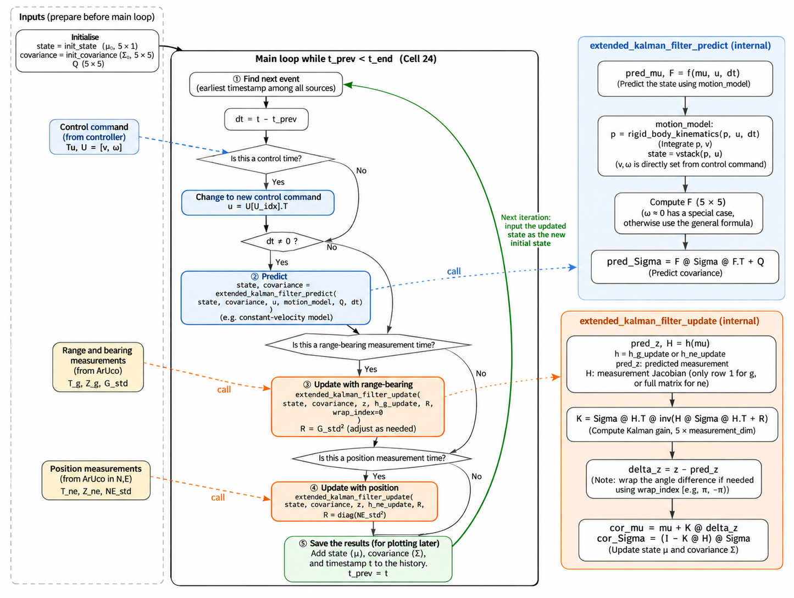

## Q1 DataLogger filename defined?

<<<<<<< Updated upstream
- No. Line 351 passes only a folder, DataLogger(log_dir="logs"). DataLogger names the file itself from the start time, The name is stored in self.datalog.filename, and stopcommand() prints it at line 386 ("Data saved in ...").
=======
## 0. Brief understanding
My first suspicion was that a few ArUco frames had been lost. While ArUco is missing, the robot relies only on the motion model, and every step carries some error (which Q is meant to describe). So after a few lost frames, the robot believes it is still on the correct path, but in reality it has drifted some distance away. Because R is very small, when ArUco comes back the estimated position p_robot is pulled almost entirely onto the ArUco measurement, which could make the robot jerk or rotate sharply. However, in Test 1 R was as large as 10, so the filter should rely much more on the motion model, and there should be no large jerk or rotation. Yet the robot still reversed. So this idea is most likely wrong.

My current guess is this. After the third turn, the robot never got within the waypoint's accept_radius, and the time had not yet exceeded the limit computed in wp_progress() (twice the scheduled time to reach the waypoint). By then, the waypoint was already behind the robot, so to reach it the robot had to rotate. After rotating, the time limit may have been exceeded, so wp_id increases by 1 and the robot starts looking for the next waypoint. Because the robot has already turned around, the new waypoint is now behind it. So, from `ds = Inverse(H_eb.H_R) @ dp`
the forward/backward component in the robot frame, ds[0], is likely negative, and ds[2], which lies in [−π, π], will be close to −π or π because the robot has turned around. The linear velocity is `v = v_ref + dv = v_ref + k_s·ds[0] = v_ref + (1/τ_s)·ds[0]`.

> `ds[0] < -v_ref · τ_s`

In our code τ_s = 1 s, and ds[0] is negative. v_ref is within [0, v_traj], and our v_traj is only 0.1 m/s, which is very small. So in this situation v will very likely be negative, which makes k_n and k_g negative as well. The angular velocity is dw = k_n·ds[1] + k_g·ds[2]. I think ds[1] can be ignored here, so dw ≈ k_g·ds[2]. Since ds[2] is close to −π or π, the resulting angular velocity is saturated at −w_max or +w_max. Therefore, after turning around, the robot body wiggles left and right, and it does not turn back to face the waypoint. Instead, it goes to the next waypoint rear first.

## 1. What we observed

- On the physical robot, the first part of the square path is tracked normally.
- After roughly the **third turn**, the robot suddenly **rotates through a large angle**, then **drives backwards (rear first)** towards the following waypoints and does not turn back.
- While reversing, the body **wiggles left and right**.
- It happened in **every test**, regardless of the Q and R values:

| Test | Q[DOTX,DOTX] | Q[DOTG,DOTG] | g_std (R heading) | n_std, e_std (R position) | Start time | Reversed? |
|---|---|---|---|---|---|---|
| Test 3 | 0.1² | deg2rad(100)² | deg2rad(0.01) | 0.01 |  | Yes |
| Test 2 | 0.01² | deg2rad(10)² | deg2rad(0.01) | 0.01 | 13:59 | Yes |
| Test 2 (changed path) | 0.01² | deg2rad(10)² | deg2rad(0.01) | 0.01 | 14:03 | Yes |
| Test 1 | 0.001² | deg2rad(1)² | deg2rad(10) | **10** | 14:10 | Yes |
---
## 2. Hypothesis 1: ArUco dropout + R too small — unlikely to be the root cause
When ArUco frames are missing, the EKF only runs the motion-model prediction. The real robot drifts because of effects the model does not capture (wheel slip, wheel-radius / wheelbase errors), but the estimate does not know this. Q only describes *how fast our uncertainty grows*; it does not cause the drift. When ArUco comes back and R is very small, the estimate jumps to the measurement in a single step, the controller suddenly sees a large error, and the robot could spin.

**I think it is not the main cause**
In **Test 1**, R was large (heading 10°, position 10), so the filter trusts the motion model much more and the estimate should change smoothly, yet the robot **still reversed**. Changing Q by two orders of magnitude also made no difference. A small R may make things worse, but it is unlikely to be the root cause.
>>>>>>> Stashed changes


## Q2 Aruco already logged in correct pose format from Line 581, this is where measurement is updated based on Aruco measurement/observation right?

- 586: convert the raw ArUco data to PoseStamped (pose_parse). Nothing is logged here.
- 590–594: save it into measured_pose_*. This only stores the measurement.
- 597: log it under /aruco.

> The **EKF measurement update is not here**. It happens later, at lines 686–696. The only thing near line 597 that changes the estimate is the one-time initialisation at line 602, which copies the first ArUco pose straight into the state.

## Q3 If we got new Aruco measurement ?

- Yes. Line 686 is if self.new_camera_measurement and self.use_measurement_update:. The update runs only when both are true: a new ArUco reading arrived in this loop (the flag is set at line 583), and updates are switched on (line 245). Line 699 resets the flag, so each reading is used only once. Loops without a camera reading do predict only.


## Q4 Here the Covariance used for for process & measurement noise in Line 681 are initialised?

- Yes. Four matrices are defined here, and each is used in a different place:
  - `init_covariance` is the initial Σ₀, used only once during initialization on line 612; `Q` is the process noise, used in the `predict` operation on line 683; `R_ne` and `R_g` are the position and heading noises of ArUco, respectively, used in the `update` operations on lines 691 and 696. Line 686 itself is merely an `if` statement; the actual lines that pass `Q` and `R` into the function are lines 683, 691, and 696.


## Q5 both return predicted & updated Sigma as self.covariance. So is it logged in Line 717 and overwritten once it is updated?

- Yes. Within one loop, the same variable is overwritten in sequence:

``` ASCII
683  predict           → self.covariance = Σ̄       (predicted)
691  update N,E        → self.covariance = Σ'      (only if new ArUco)
696  update yaw        → self.covariance = Σ       (only if new ArUco)
712  self.cov = self.covariance   (for the GUI ellipse)
723  log "/est_cov"    ← logged ONCE per loop, after all of the above
```

> So each /est_cov entry holds the final Σ of that loop. On a loop with a camera reading, that is the posterior after both updates. On a loop without one, it is the predicted Σ̄. On camera loops, the intermediate Σ̄ is not logged.


## Q6 Aren't the data we intended to log (Aruco, LiDar, Sigma) logged already

- Yes. Every loop and every callback already writes to the same JSON file:
    1. /true_wheel_speeds	402
    2. /lidar	450
    3. /aruco	597
    4. /est_pose	719
    5. /est_cov	723
    6. /wheel_speeds_cmd	829




